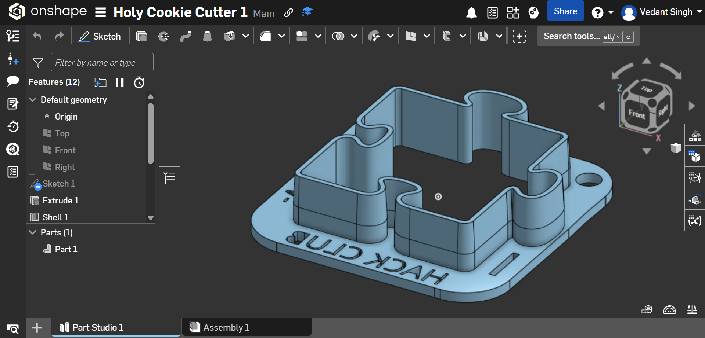
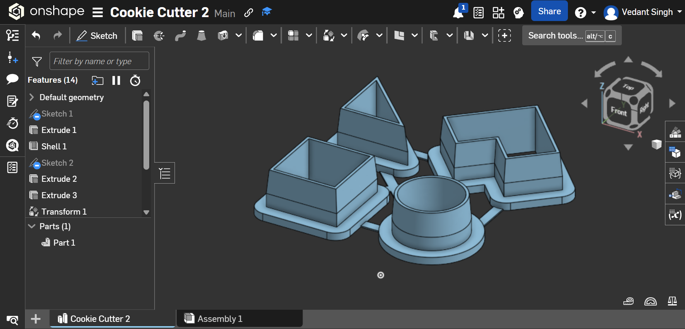
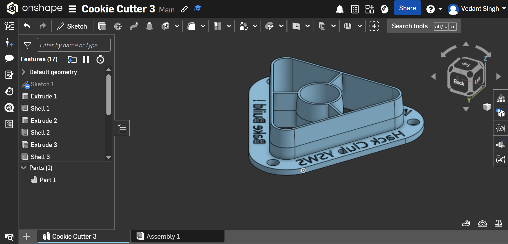

# cookie-cutters
Some cool, simple, and easily printable cookie cutters.

## About
Hello, this is my first GitHub repository. I designed each cutter from scratch in Onshape and exported them as STEP files for 3D printing on a standard desktop printer. These cookie cutters are printable without supports.

## What's in this repo?
- 3 cookie cutter designs, made in Onshape
- .step files for anyone who wants to 3D print their own
- Photos of the design
- Links to directly view the designs in Onshape
  
## Shapes
1. Cutter 1- Jigsaw puzzle piece
2. Cutter 2- Group of various basic shapes
3. Cutter 3- Derived shapes

## The screenshots
### Cookie Cutter 1 

### Cookie Cutter 2 

### Cookie Cutter 3 

## The .step files
1. [Cutter 1](Hardware/Cookie-Cutter-1.step)

2. [Cutter 2](Hardware/Cookie-Cutter-2.step)

3. [Cutter 3](Hardware/Cookie-Cutter-3.step)

## The clickables to view them live in Onshape
1. [Cutter 1](https://cad.onshape.com/documents/48742a1481ec55967b4d5ffd/w/b9a18b38e6bc664d6011095e/e/83b0f16c2f3313b969ecf8cf)

2. [Cutter 2](https://cad.onshape.com/documents/afa470dbf9095d0e75139332/w/ddbc25f96dd87806abe0790a/e/04c4dd53b5cc922e2a031d65)

3. [Cutter 3](https://cad.onshape.com/documents/126236586f997718e71512a3/w/e0f0970f2bcedf026f500b45/e/85c5ee28585bf1e0bd14b74c)

## Notes
Feel free to check my other repositories and latest projects [here](https://github.com/vd-sh) :)
